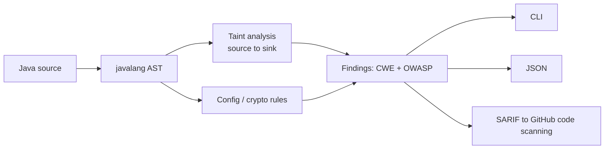

# JSecPy

[](https://github.com/lohith80/JSecPy/actions/workflows/ci.yml)
[](LICENSE)
[](pyproject.toml)

**Static application security testing (SAST) for Java, powered by AST + taint
analysis, mapped to CWE and the OWASP Top 10, with SARIF output for GitHub code
scanning.**

JSecPy parses Java source to an abstract syntax tree and tracks how
attacker-controlled data flows from **sources** (servlet parameters, headers,
request bodies, CLI args) to dangerous **sinks** (SQL, OS commands, file paths,
URLs, LDAP, XPath). Because it understands data flow, it reports SQL injection
when user input actually reaches a query, not every line that merely mentions
`Statement`.



## Why not just grep?

A keyword scanner flags `MessageDigest`, `Statement`, or `exec` wherever they
appear and buries you in false positives. JSecPy is different:

```java
// FLAGGED (JSEC-SQLI, HIGH): user input flows into the query
String name = req.getParameter("name");
stmt.executeQuery("SELECT * FROM users WHERE name = '" + name + "'");

// NOT FLAGGED: parameterized query, input is bound safely
PreparedStatement ps = conn.prepareStatement("SELECT * FROM users WHERE name = ?");
ps.setString(1, req.getParameter("name"));
ps.executeQuery();
```

Both lines mention SQL. Only the first is a vulnerability, and only the first
is reported.

## Install

```bash
pip install "jsecpy @ git+https://github.com/lohith80/JSecPy@v2.1.0"
# or from source:
git clone https://github.com/lohith80/JSecPy && cd JSecPy && pip install -e ".[dev]"
```

## Usage

```bash
jsecpy src/main/java                     # scan a directory
jsecpy App.java --min-severity MEDIUM    # single file, raise the floor
jsecpy src/ --format sarif -o out.sarif  # SARIF for code scanning
jsecpy src/ --format json -o report.json # machine-readable
jsecpy --list-rules                      # show the rule catalog
```

Example finding:

```
[CRITICAL] SQL Injection  (JSEC-SQLI, high confidence)
  src/UserDao.java:42
  > ResultSet rs = st.executeQuery(query);
  SQL Injection: attacker-controlled input reaches st.executeQuery().
  CWE: CWE-89    OWASP: A03:2021-Injection
    flow: line 39 source: req.getParameter
    flow: line 42 sink: st.executeQuery
  Fix: Use PreparedStatement with parameterized queries...
```

## Detections

14 built-in rules across the OWASP Top 10. Run `jsecpy --list-rules` for the
live list; full catalog in [docs/RULES.md](docs/RULES.md).

| Rule | Detects | CWE | OWASP |
|------|---------|-----|-------|
| JSEC-SQLI | SQL injection (taint into JDBC/JPA queries) | CWE-89 | A03 |
| JSEC-CMDI | OS command injection | CWE-78 | A03 |
| JSEC-PATH | Path traversal | CWE-22 | A01 |
| JSEC-SSRF | Server-side request forgery | CWE-918 | A10 |
| JSEC-LDAP | LDAP injection | CWE-90 | A03 |
| JSEC-XPATH | XPath injection | CWE-643 | A03 |
| JSEC-REDIR | Open redirect | CWE-601 | A01 |
| JSEC-HASH | Weak hashing (MD5, SHA-1) | CWE-328 | A02 |
| JSEC-CIPHER | Weak cipher / ECB mode | CWE-327 | A02 |
| JSEC-RANDOM | Insecure randomness | CWE-330 | A02 |
| JSEC-XXE | XML external entity exposure | CWE-611 | A05 |
| JSEC-DESER | Unsafe deserialization | CWE-502 | A08 |
| JSEC-TLS | Disabled TLS validation | CWE-295 | A07 |
| JSEC-COOKIE | Insecure cookie flags | CWE-614 | A05 |
| JSEC-SECRET | Hardcoded secrets | CWE-798 | A07 |

Plus a **YAML rule engine** so teams add their own sinks with no code, and
Python rules for anything structural. See [docs/WRITING_RULES.md](docs/WRITING_RULES.md).

## GitHub Action

Add SAST to any Java repo and get findings as PR annotations:

```yaml
# .github/workflows/security.yml
name: JSecPy
on: [pull_request]
permissions:
  contents: read
  security-events: write   # required to upload SARIF
jobs:
  sast:
    runs-on: ubuntu-latest
    steps:
      - uses: actions/checkout@v4
      - uses: lohith80/JSecPy@v2.1.0
        with:
          paths: src/main/java
          fail-on: HIGH
```

## CI ergonomics

- **Exit codes:** `0` clean, `1` findings at/above `--fail-on` (default HIGH),
  `2` usage error - so it gates a pipeline out of the box.
- **Baselines:** `jsecpy src/ --write-baseline .jsecpy-baseline.json` snapshots
  current findings; future runs with `--baseline` only report new ones. Adopt
  JSecPy on a legacy codebase without drowning in day-one noise.
- **Inline suppression:** `// jsecpy:ignore` or `// jsecpy:ignore[JSEC-SQLI]`
  on the finding's line, greppable and reviewable.
- **Config file:** `.jsecpy.yml` for severity thresholds, excludes, disabled
  rules, and custom rule paths. See [.jsecpy.example.yml](.jsecpy.example.yml).

## Confidence and honesty

Findings are HIGH confidence when taint is proven from source to sink, MEDIUM
when a value is dynamically built but taint could not be proven. JSecPy is
intra-procedural and does not resolve types across a build graph; it is a
high-signal first pass and CI gate, **not** a proof of correctness. Read
[docs/THREAT_MODEL.md](docs/THREAT_MODEL.md) for the full capability and
limitation statement.

**Adversarially tested.** The engine is validated by
[tests/test_redteam_corpus.py](tests/test_redteam_corpus.py): 43 Java cases
from a red-team pass, split into detections that must fire, safe code that must
stay silent (the anti-false-positive contract), and documented gaps encoded as
`xfail`. CI enforces zero missed detections and zero false positives on that
corpus, and every known limitation is a visible failing-the-day-it-regresses
test rather than a footnote.

## Contributing

The most valuable contributions are **detection gaps**: a vulnerable Java
snippet JSecPy misses, or safe code it wrongly flags. Open an issue with the
snippet. New rules need a vulnerable and a safe fixture. Security issues in the
scanner itself go through [SECURITY.md](SECURITY.md).

## License

MIT - see [LICENSE](LICENSE).
